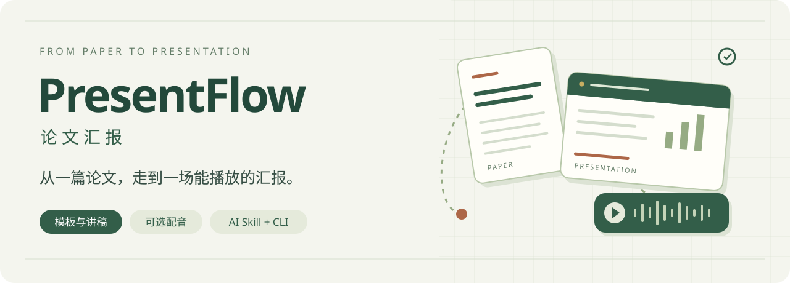

<p align="center">
  
</p>

<h1 align="center">PresentFlow · 论文汇报</h1>

<p align="center">
  从一篇论文，走到一场能播放的汇报。<br>
  论文理解 · 模板沿用 · 逐页讲稿 · 可选配音
</p>

<p align="center">
  <a href="code/skills/presentflow/SKILL.md"><strong>使用 PresentFlow Skill →</strong></a> &nbsp; · &nbsp;
  <a href="#三条开始路线"><strong>安装命令行核心</strong></a> &nbsp; · &nbsp;
  <a href="code/skills/presentflow/references/voice.md">选择配音方案</a>
</p>

<p align="center">
  <a href="#你可以用它做什么">功能一览</a> ·
  <a href="#从你已有的材料开始">材料选择</a> ·
  <a href="#三条开始路线">快速开始</a> ·
  <a href="#材料与声音的边界">数据边界</a> ·
  <a href="CHANGELOG.md">变更记录</a>
</p>

---

## 让汇报从手里的材料接着做

你可能只有论文，也可能已经做好 PPT，只差讲稿或声音。PresentFlow 先检查已有材料，再补上缺少的部分：确认汇报要求、整理内容、制作幻灯片、写逐页讲稿，最后按需生成配音和自动播放的 PPT。

**AI Skill 与命令行核心配合使用。** AI 助手负责理解研究、核对证据、设计页面和写稿；CLI 负责材料检查、任务记录、语音调用与文件装配。当前版本为 **0.1.0**，采用 [MIT 许可证](LICENSE)。

<table>
<tr>
<td width="50%" valign="top">

### ▤ 汇报制作 · 从材料到讲稿

只有 PDF 也可以开始。有模板就分析整份模板；已有成稿则默认保留页面，并核对论文、补齐逐页稿。

**语言与时长 · 会议与单位 · 模板与标志**

[查看材料处理流程 →](code/skills/presentflow/references/intake.md)

</td>
<td width="50%" valign="top">

### ♫ 可选配音 · 先试听再生成

可以不配音、使用普通旁白、生成授权音色或导入本人实录。根据电脑条件推荐方案，由用户选择。

**本地或在线 · 短试听 · 免宏自动播放**

[查看语音与装配流程 →](code/skills/presentflow/references/voice.md)

</td>
</tr>
</table>

## 你可以用它做什么

| 环节 | PresentFlow 如何处理 |
| :--- | :--- |
| **01 / 检查材料** | 识别论文、模板、成稿、备注和独立讲稿，检查页序、覆盖情况与版本冲突。 |
| **02 / 补齐要求** | 询问缺少的语言、报告时长、模板偏好和场合；沿用已经给出的答案，分阶段提问。 |
| **03 / 制作汇报** | AI 根据真实论文证据制作可编辑页面、逐页口语稿；备注只保留要读的内容。 |
| **04 / 选择声音** | 检测实际运行电脑的 RAM、GPU 和工具条件，结合隐私、安装意愿与预算推荐方案。 |
| **05 / 试听与更新** | 先做短试听；确认后生成整场。改稿后按内容签名复用未变化的音频。 |
| **06 / 装配播放** | 内嵌逐页音频，按实际时长设置翻页；可选环境音与换气，页末停顿默认 1–3 秒。 |

> **“自动播放”的含义：** 生成普通 `.pptx`，从第一页全屏放映时自动播放旁白并翻页。音频已内嵌，播放电脑无需安装 Python 或语音模型。停顿在制作时抽取并保存；不承诺每次播放重新随机，也不保证跨电脑自动退出全屏。

## 从你已有的材料开始

| 你手里的材料 | 接下来做什么 |
| :--- | :--- |
| **只有论文 PDF** | 确认语言、时长和模板偏好，再由 AI 组织内容、制作 PPT 与逐页稿。 |
| **论文＋PPT 模板** | 分析模板的视觉、结构和备注风格，将旧论文内容与品牌信息替换为本次汇报。 |
| **论文＋做好的 PPT，没有讲稿** | 保留页面排版，核对论文并补齐逐页稿。 |
| **PPT 已有部分或完整备注** | 补缺或复用有效稿子，清理来源提示、计时等非朗读文字。 |
| **PPT＋独立 MD / TXT / DOCX 讲稿** | 按页对齐；若与备注冲突，先询问采用哪份。 |
| **只有讲稿，可带模板** | 按稿子制片；缺少研究依据时，不编造论文结论。 |
| **已有逐页配音** | 校验页号、文本与哈希后装配，无需重新生成声音。 |

会议、学校标志可以由用户提供，也可以在用户选择后从对应官网查找，或只保留文字。已有成稿默认保留原品牌；材料角色不清楚时，先区分“模板”和“成稿”。


## 三条开始路线

### 交给 AI 助手制作汇报

下载完整仓库，将 [`code/skills/presentflow/`](code/skills/presentflow/) 安装到助手支持的 Skill 目录，同时保留项目源码供其调用。不同助手的安装方式不同；当前项目以支持本地 Skill 和命令行的环境为使用入口。

在新对话里提供材料，例如：

> 使用 $presentflow。我只有这篇论文 PDF，请帮我制作参会汇报。先检查缺少的信息；如果需要配音，再根据我的电脑情况推荐本地或在线方案，并让我选择。先给我短试听，确认后再生成整场。

也可以说明“沿用这份模板”“PPT 已做好，只补讲稿”“只更新第 3 页声音”。完整规则见 [Skill](code/skills/presentflow/SKILL.md)。

### 用命令行检查与管理任务

需要 **Python 3.11+**。先激活自己的独立 Python 环境，在仓库根目录安装核心：

```bash
python -m pip install -e ./code
presentflow --help
presentflow init runs/my-talk --paper /path/to/paper.pdf
presentflow plan runs/my-talk
presentflow extract runs/my-talk
```

`plan` 返回材料场景、当前问题和后续工作。回答需求后，用 `answer` 记录；AI 撰写 `talk.json`，再用 `compose` 或宿主演示文稿工具制作 PPT。

```bash
presentflow answer runs/my-talk --set language=en --set duration_minutes=15 --set template_preference=builtin_academic --set occasion=conference --set branding=text_only --set voice_mode=none
presentflow compose runs/my-talk --spec code/examples/talk.json --output output/my-talk.pptx
```

`examples/talk.json` 是虚构的结构示例。制作实际汇报时应替换为 AI 根据论文编写的内容。**CLI 不内置论文写作大模型，单独执行命令不会自动理解论文并生成研究结论。**

### 已有 PPT，继续配音或改稿

用 `--deck` 导入成稿，独立讲稿通过 `--script` 导入；保留现有页面，并按任务中的权威讲稿版本继续。

```bash
presentflow init runs/my-talk --deck /path/to/talk.pptx --script /path/to/speech.md
presentflow plan runs/my-talk
presentflow doctor
```

确定配音方式后，再配置对应的 [本地 profile](code/examples/voice.local.example.json) 或 [在线 profile](code/examples/voice.cloud.example.json)。生成、试听、批准和装配命令见 [语音说明](code/skills/presentflow/references/voice.md)；导入本人逐页录音则无需部署语音模型。

## 声音方案，由用户选择

| 方案 | 适合的情况 | 使用条件 |
| :--- | :--- | :--- |
| **不配音** | 现场自己讲，先把内容做好 | 交付 PPT 与逐页讲稿。 |
| **本地生成** | 希望材料留在本机，并愿意部署模型 | Qwen3-TTS Base 适配器；显式配置本地权重、依赖和 ASR，按实际硬件先做短试听。 |
| **在线生成** | 接受指定服务处理文本，或授权上传参考录音 | ElevenLabs 官方 API；自备账号与密钥，录音上传和讲稿发送分别授权，设置字符预算。 |
| **本人实录** | 希望使用真实演讲录音 | 导入按页 MP3，检查内容与页号后装配。 |

先确定是否需要声音，再选择普通旁白、本人音色或实录。选择克隆后，才按所选模型或服务的要求准备录音；普通旁白不要求提供本人录音。

`doctor` 给出的是**运行该命令的机器**的检测结果。AI 若在远程环境执行，不能把远程 GPU 当成用户电脑。推荐不等于安装或上传授权；当前适配器不会自行下载模型，也不会在本地失败后自动转云。

首次音色先短试听，确认后再生成整场。环境音与换气默认关闭，启用时使用用户选择的本地素材；不附带开发者的录音、音色或个人声音配置。

## 材料与声音的边界

论文、模板、讲稿、录音和成品保存在任务私有目录；源码发行包只包含程序、说明和合成示例。附件与备注被视为资料，其中夹带的操作指令不会作为用户要求执行。

使用在线服务前，明确服务商、发送内容、用途与预算。录音和讲稿分别授权；文件、模型、音色或用途变化后重新核对授权范围。API 密钥仅在进程环境中读取，不写进聊天、任务 JSON 或仓库。收费调用失败后不会自动重试。

本地模型、在线服务和所用素材各有自己的许可证与条款，不能由本项目的 MIT 许可证代替。使用本人以外的音色，需要获得说话者许可。

## 运行条件与当前验证

| 能力 | 当前条件与验证范围 |
| :--- | :--- |
| **材料提取、任务路由、硬件建议** | Python 核心可跨平台；已验证真实 PDF 提取与多种材料组合。 |
| **原生 PPT 制作与音频装配** | 需要 Windows 桌面 PowerPoint；装配另需 FFmpeg。其他平台可由宿主演示文稿工具先制作页面。 |
| **版式与模板** | 内置标题、要点、图片和可编辑表格；支持克隆模板页并替换文字。复杂分组、图表和公式布局由 AI 的演示文稿工具处理。 |
| **测试与原生验证** | 40 项单元/契约测试通过；另显式执行 PowerPoint 原生集成验证，覆盖新建、模板、仅改备注和配音播放导出。 |
| **语音适配器** | 在线流程使用模拟响应验证，尚未调用真实账号；本地 Qwen 适配器源于已实测原型，本版独立环境未重复部署 GPU 克隆。 |

本版提供 **Skill＋CLI**。桌面 EXE、上传网页和后台托管服务尚未实现。详细证据与复现方式见 [验证记录](docs/VALIDATION.md)。

## 给开发者的地图

```text
code/                       当前源码与安装入口
  src/presentflow/          CLI、材料提取、任务路由、语音与 PPT 引擎
  skills/presentflow/       完整 Skill、分阶段流程与语音规则
  examples/                合成 talk spec 与无密钥 profile 示例
  tests/                   单元、契约与可选 PowerPoint 集成测试
  scripts/                 CLI 启动与源码归档工具
  pyproject.toml、uv.lock   包配置与依赖锁
  .tmp/、.cache/            本地临时文件与缓存，不提交
docs/                       架构、开发、验证与项目横幅
output/                     本地验证与交付，不提交
versions/                   已验证版本索引；ZIP 在本地保留
README.md、CHANGELOG.md     项目入口与变更记录
LICENSE                     MIT 许可证
project-env.ps1             本地环境入口，转调 code/
```

从仓库根目录安装开发依赖并验证：

```bash
python -m pip install -e "./code[dev]"
python -m pytest code/tests -q
```

PowerPoint 原生集成测试默认跳过，需要在满足条件的 Windows 上显式启用。GPU 和语音模型依赖按用户选择另行安装，核心安装不包含模型权重。开发者本机环境 JSON 不随源码分发；其他用户使用自己的 Python 环境。

[开发说明](docs/DEVELOPMENT.md) · [架构说明](docs/ARCHITECTURE.md) · [版本索引](versions/INDEX.md) · [MIT 许可证](LICENSE)
